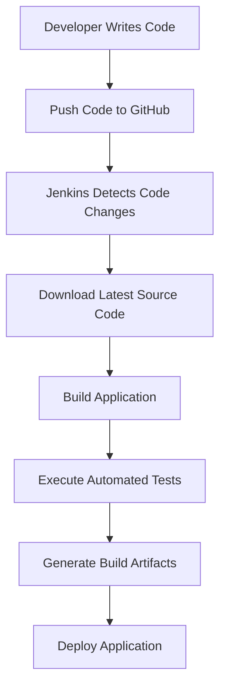

# 1. What is Jenkins?

## 1.1 Introduction

Jenkins is an open-source automation server used to automate software development activities such as building, testing, and deploying applications.

Jenkins is widely used in DevOps to implement Continuous Integration (CI) and Continuous Delivery/Deployment (CD).

### In Simple Words

Jenkins is an automation tool that executes predefined tasks automatically based on configured triggers.

Instead of performing repetitive software development activities manually, we configure Jenkins to perform those activities automatically.

## 1.2 What Is Automation?

Automation means performing tasks automatically without requiring someone to execute every individual step manually.

### Real-World Example

Imagine you are working in a software development company.

Every day, developers write application code and push their changes to a GitHub repository.

Whenever developers make changes, someone needs to:

1. Download the latest source code.
2. Compile the application.
3. Check whether compilation is successful.
4. Execute test cases.
5. Generate build files.
6. Deploy the application to a server.

If these activities are performed manually every day, they consume time and increase the possibility of human errors.

Jenkins helps automate these activities.

## 1.3 What Is the Main Purpose of Jenkins?

The main purpose of Jenkins is to automate repetitive software development and delivery activities.

Jenkins can automate:

- Source code retrieval.
- Application compilation.
- Application building.
- Automated testing.
- Build artifact generation.
- Application deployment.
- Scheduled execution of tasks.

## 1.4 How Does Jenkins Work? (Basic Understanding)

Let's understand Jenkins with a simple example.

Imagine a developer makes changes to an application and pushes the code to GitHub.

Jenkins can be configured to detect these changes and start an automated workflow.

### Basic Jenkins Workflow

### Step-by-Step Explanation

**Step 1: Developer Writes Code**

A developer writes or modifies application source code.

**Step 2: Push Code to GitHub**

The developer uploads the latest changes to a GitHub repository.

**Step 3: Jenkins Detects Code Changes**

Jenkins receives a trigger, such as a GitHub webhook, and starts the configured job or pipeline.

**Step 4: Download Latest Source Code**

Jenkins retrieves the application source code from the GitHub repository. This process is called Source Code Checkout.

**Step 5: Build Application**

Jenkins executes the required build commands to compile or package the application.

**Step 6: Execute Automated Tests**

Jenkins executes configured test cases to verify application functionality.

**Step 7: Generate Build Artifacts**

Jenkins can preserve the generated application files, such as JAR, WAR, or other build outputs.

**Step 8: Deploy Application**

If the required stages succeed, Jenkins can execute the configured deployment process.

**Important:** Jenkins does not automatically know how to perform all these activities. We must configure the required jobs, pipelines, tools, commands, and permissions.

## 1.5 Where Is Jenkins Used?

Jenkins is commonly used in the following areas:

| Area | Usage |
|---|---|
| Continuous Integration | Automatically builds and tests application code changes. |
| Continuous Delivery | Automates the preparation of applications for release. |
| Continuous Deployment | Automates application releases to target environments. |
| Build Automation | Automates application compilation and packaging. |
| Test Automation | Executes automated test cases. |
| Deployment Automation | Automates application deployment. |
| Scheduled Jobs | Executes tasks at predefined times. |

## 1.6 Important Jenkins Terminology

Before learning Jenkins practically, understand these basic terms.

| Term | Meaning |
|---|---|
| Automation | Performing tasks automatically. |
| CI | Continuous Integration. |
| CD | Continuous Delivery or Continuous Deployment. |
| Job | A configured unit of work in Jenkins. |
| Pipeline | A sequence of automated stages and steps. |
| Build | An execution of a job or pipeline, often producing an application output. |
| Trigger | An event or condition that starts a job or pipeline. |
| Workspace | Directory where Jenkins performs build-related operations. |
| Artifact | A file generated during the build process. |
| Console Output | Logs showing what happened during job execution. |
| Plugin | An extension that adds functionality to Jenkins. |

## 1.7 Is Jenkins an Open-Source Tool?

Yes. Jenkins is an open-source automation server.

It is maintained by a community of contributors and has a large ecosystem of plugins.

### Official Resources

- Official Website: https://www.jenkins.io/
- Official Documentation: https://www.jenkins.io/doc/

## 1.8 Important Points to Remember

1. Jenkins is an open-source automation server.
2. Jenkins is widely used in DevOps.
3. Jenkins automates repetitive software development activities.
4. Jenkins supports Continuous Integration and Continuous Delivery/Deployment.
5. Jenkins can integrate with GitHub.
6. Jenkins can automate building, testing, and deploying applications.
7. Jenkins executes tasks based on configured jobs and pipelines.
8. Jenkins supports plugins to extend its functionality.

## 1.9 Interview Questions and Answers

**Q1. What is Jenkins?**

Jenkins is an open-source automation server used to automate software development activities such as building, testing, and deploying applications.

**Q2. Why do we use Jenkins?**

We use Jenkins to automate repetitive software development tasks, reduce manual effort, improve consistency, and speed up software delivery.

**Q3. Is Jenkins open-source?**

Yes. Jenkins is an open-source automation server.

**Q4. What are the common uses of Jenkins?**

Jenkins is commonly used for Continuous Integration, Continuous Delivery, Continuous Deployment, automated builds, software testing, and application deployment.

**Q5. Can Jenkins integrate with GitHub?**

Yes. Jenkins can integrate with GitHub to retrieve source code and trigger automated jobs when code changes occur.

**Q6. Does Jenkins automatically build an application without configuration?**

No. Jenkins requires the necessary configuration, build instructions, tools, and permissions to execute the application build process.

**Q7. What is a Jenkins job?**

A Jenkins job is a configured unit of work that Jenkins executes to perform a particular task.

**Q8. What is a Jenkins plugin?**

A Jenkins plugin is an extension that adds additional features and integrations to Jenkins.

## 1.10 Practice Assignment

Complete these questions without looking at the notes first.

1. Explain Jenkins in your own words.
2. What problem does Jenkins solve?
3. Explain the basic Jenkins workflow.
4. What happens when a developer pushes code to GitHub?
5. What is the difference between manual execution and automation?
6. Name five activities that Jenkins can automate.
7. What is a Jenkins job?
8. What is a Jenkins plugin?

### Practical Thinking Exercise

Imagine you are working as a DevOps engineer in a company.

There are 10 developers pushing code to GitHub every day.

Answer these questions:

- Why would manual application building become difficult?
- How can Jenkins help the development team?
- What activities would you automate using Jenkins?

Write your answers in your own words.

## 1.11 Lesson 1 Conclusion

Jenkins is an automation server that helps development teams automate repetitive software development and delivery activities.

It reduces manual effort, improves consistency, and helps teams deliver software efficiently.

**Remember: Jenkins is not just a tool for executing commands. It is an automation platform that helps implement software delivery workflows.**
