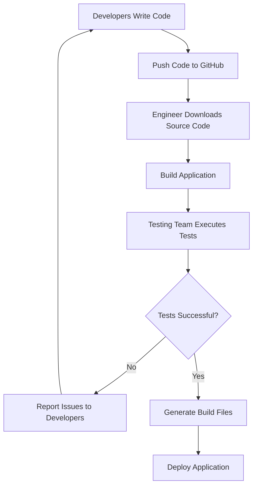
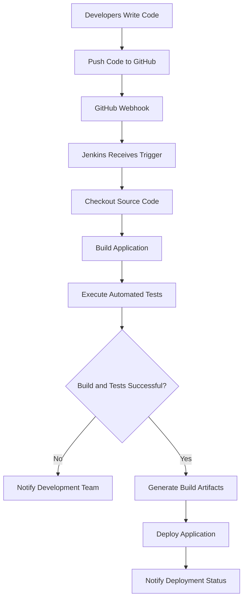

# 2. Why Do We Need Jenkins?

## 2.1 Introduction

In the previous lesson, we understood what Jenkins is and how it helps automate software development activities.

Now let's understand an important question:

**Why do companies actually need Jenkins?**

To understand this, we first need to understand how software development and delivery happen in a real-world company.

When multiple developers work on the same application, managing code changes, building applications, testing, and deploying them manually becomes difficult.

Jenkins helps solve these challenges through automation.

## 2.2 Real-World Company Scenario

Imagine you are working in a software development company.

The company has a development team consisting of:

- 10 Developers
- 3 Testing Engineers
- 2 Deployment Engineers
- 1 DevOps Engineer

The developers work on the same application but handle different functionalities.

For example:

| Developer | Responsibility |
|---|---|
| Developer 1 | Login functionality |
| Developer 2 | Registration functionality |
| Developer 3 | Payment functionality |
| Developer 4 | User management |
| Developer 5 | Reporting functionality |
| Developer 6-10 | Other application functionalities |

All developers push their code changes to a common GitHub repository.

Whenever developers make changes, the application needs to be built and tested to ensure that the new changes do not break existing functionality.

Let's understand what happens without Jenkins.

## 2.3 Software Delivery Without Jenkins

Without Jenkins, the team needs to perform several activities manually.

### Manual Process

1. Developers write application code.
2. Developers push code to GitHub.
3. A deployment engineer downloads the latest source code.
4. The engineer executes application build commands.
5. The testing team executes test cases.
6. The team identifies and reports errors.
7. Developers fix the reported issues.
8. The application is built again.
9. The deployment engineer deploys the application to the server.

### Manual Software Delivery Workflow

### Problems with Manual Software Delivery

The manual process creates several challenges.

**1. Time Consumption**

Engineers spend considerable time downloading code, building applications, executing tests, and deploying applications.

**2. Human Errors**

Engineers may execute incorrect commands, use the wrong source code version, or miss important steps.

**3. Delayed Feedback**

Developers may not immediately know whether their code changes have introduced errors.

**4. Repetitive Work**

The same activities need to be performed every time a new application version is released.

**5. Inconsistent Process**

Different engineers may follow different procedures while building and deploying applications.

**6. Difficult to Manage Multiple Developers**

When multiple developers push changes frequently, manually building and testing every change becomes difficult.

**7. Delayed Software Delivery**

Manual activities increase the time required to release application updates.

## 2.4 Why Do We Need Automation?

To overcome these problems, companies introduce automation into their software development process.

Automation allows repetitive activities to be executed automatically based on predefined instructions and triggers.

Instead of manually performing every activity, we configure an automation server to execute the required tasks.

Jenkins is one of the tools used for this purpose.

### How Jenkins Helps

Jenkins can automate the following activities:

| Activity | How Jenkins Helps |
|---|---|
| Source Code Retrieval | Automatically retrieves source code from GitHub. |
| Application Building | Executes configured build commands. |
| Testing | Executes automated test cases. |
| Build Validation | Identifies whether the build process succeeds or fails. |
| Artifact Generation | Stores generated build files when configured. |
| Deployment | Executes configured deployment procedures. |
| Notifications | Sends build status notifications through configured integrations. |

## 2.5 Software Delivery With Jenkins

Now imagine the same company uses Jenkins.

The developers continue writing code and pushing changes to GitHub.

However, Jenkins is configured to automate the software delivery process.

Whenever a developer pushes code, GitHub can notify Jenkins through a webhook.

Jenkins then starts the configured pipeline.

### Automated Software Delivery Workflow

### Step-by-Step Explanation

**Step 1: Developers Write Code**

Developers write new application features or modify existing functionality.

**Step 2: Push Code to GitHub**

Developers push their changes to the shared GitHub repository.

**Step 3: GitHub Webhook**

GitHub sends an HTTP notification to Jenkins when the configured repository event occurs.

**Step 4: Jenkins Receives Trigger**

Jenkins receives the notification and starts the configured job or pipeline.

**Step 5: Checkout Source Code**

Jenkins retrieves the latest required source code from the GitHub repository.

**Step 6: Build Application**

Jenkins executes the configured commands to compile or package the application.

**Step 7: Execute Automated Tests**

Jenkins executes the configured automated test cases.

**Step 8: Check Build and Test Results**

Jenkins evaluates the execution results.

- If the build or tests fail, the pipeline can stop and notify the development team.
- If the required stages succeed, the pipeline can continue.

**Step 9: Generate Build Artifacts**

Jenkins can archive the generated application files for later use.

**Step 10: Deploy Application**

Jenkins executes the configured deployment steps to release the application.

**Step 11: Send Notifications**

Jenkins can notify the development or deployment team about the execution status.

**Important:** Jenkins does not automatically perform these activities just by being installed. The DevOps engineer must configure the required pipeline, commands, tools, integrations, and permissions.

## 2.6 Manual Process vs Jenkins Automation

Let's compare both approaches.

| Activity | Without Jenkins | With Jenkins |
|---|---|---|
| Code retrieval | Manual | Automated |
| Application building | Manual | Automated |
| Testing | Manual execution | Automated execution |
| Build validation | Manual checking | Pipeline evaluates results |
| Artifact generation | Manual process | Automated when configured |
| Deployment | Manual execution | Automated when configured |
| Notifications | Manual communication | Automated notifications when configured |
| Execution history | Manually maintained | Available in Jenkins build history |
| Repetitive activities | Performed manually | Executed through configured automation |

## 2.7 Benefits of Using Jenkins

### 1. Automation

Jenkins automates repetitive software development activities.

### 2. Faster Feedback

Developers can receive build and test results shortly after code changes are submitted.

### 3. Early Error Detection

Build failures and test failures can be identified earlier in the development process.

### 4. Consistency

Jenkins executes configured steps in a repeatable manner.

### 5. Reduced Manual Effort

Engineers spend less time performing repetitive activities.

### 6. Integration

Jenkins integrates with tools such as GitHub and many other development and testing tools through plugins and integrations.

### 7. Build History

Jenkins maintains build execution history, status information, and console logs.

### 8. Scheduled Automation

Jenkins can execute configured jobs at predefined times.

## 2.8 Does Jenkins Eliminate Manual Work Completely?

No.

Jenkins reduces repetitive manual work, but human involvement is still required.

For example:

- Developers write and maintain application code.
- DevOps engineers configure and maintain Jenkins.
- Testing engineers design and maintain test cases.
- Deployment approvals may require human authorization.
- Engineers investigate failures and fix underlying problems.

Jenkins automates the activities that we configure. It does not replace the people responsible for software development and operations.

## 2.9 When Do Companies Use Jenkins?

Companies commonly use Jenkins in the following situations:

| Situation | Jenkins Usage |
|---|---|
| Developers frequently push code | Automatically build and test code changes. |
| Applications require regular releases | Automate release preparation and deployment. |
| Repeated application builds are required | Execute build jobs automatically. |
| Automated tests need to run frequently | Execute test suites through pipelines. |
| Scheduled maintenance tasks are required | Run scheduled Jenkins jobs. |
| Multiple environments are used | Automate configured deployment workflows. |

## 2.10 Important Points to Remember

1. Companies use Jenkins to automate repetitive software delivery activities.
2. Manual software delivery consumes time and increases the possibility of errors.
3. Jenkins can integrate with GitHub to retrieve source code.
4. GitHub webhooks can trigger Jenkins jobs when configured.
5. Jenkins can automate application building and testing.
6. Jenkins can automate artifact generation and deployment.
7. Jenkins provides build history and console logs.
8. Jenkins reduces manual effort but does not eliminate human involvement.
9. Jenkins requires proper configuration to execute automation tasks.
10. Jenkins is widely used to implement CI/CD workflows.

## 2.11 Interview Questions and Answers

**Q1. Why do companies use Jenkins?**

Companies use Jenkins to automate repetitive software development activities such as building, testing, and deploying applications. It reduces manual effort and improves software delivery efficiency.

**Q2. What problems does Jenkins solve?**

Jenkins helps solve problems such as repetitive manual builds, delayed feedback, inconsistent execution, and time-consuming software delivery activities.

**Q3. What happens when multiple developers push code frequently?**

Without automation, engineers need to repeatedly retrieve, build, and test application code. Jenkins can automate these activities through configured jobs and pipelines.

**Q4. How does Jenkins integrate with GitHub?**

Jenkins can connect to GitHub to retrieve source code. GitHub webhooks can notify Jenkins about repository events and trigger configured jobs.

**Q5. Does Jenkins automatically deploy an application?**

No. Jenkins can deploy applications only when the required deployment steps, scripts, credentials, permissions, and configurations are provided.

**Q6. How does Jenkins help developers?**

Jenkins helps developers by automatically building and testing their code changes and providing faster feedback about build and test failures.

**Q7. Can Jenkins send notifications?**

Yes. Jenkins can send notifications through configured plugins and integrations when builds or pipelines succeed or fail.

**Q8. Does Jenkins replace DevOps engineers?**

No. Jenkins is an automation tool. DevOps engineers are responsible for designing, configuring, maintaining, monitoring, and troubleshooting automation workflows.

**Q9. Can Jenkins execute jobs at a particular time?**

Yes. Jenkins supports scheduled job execution using configured build triggers, including cron-style schedules.

**Q10. What is the main advantage of Jenkins?**

Its main advantage is automating repetitive software delivery activities, helping teams improve consistency and reduce manual effort.

## 2.12 Practice Assignment

Answer the following questions without referring to the documentation.

1. Why do companies need Jenkins?
2. What problems occur during manual software delivery?
3. How does Jenkins reduce manual effort?
4. Explain the software delivery process without Jenkins.
5. Explain the software delivery process with Jenkins.
6. What is the role of a GitHub webhook?
7. What happens when a Jenkins build fails?
8. How does Jenkins help developers?
9. Does Jenkins eliminate the need for DevOps engineers?
10. Mention five benefits of using Jenkins.

### Practical Thinking Exercise

Imagine you are working as a DevOps engineer in a company.

The company has:

- 10 Developers.
- 3 Testing Engineers.
- 2 Deployment Engineers.
- 1 Shared GitHub repository.
- Multiple application releases every day.

Answer these questions:

1. What problems might the company face if it follows manual software delivery?
2. Which activities would you automate using Jenkins?
3. How would GitHub communicate code changes to Jenkins?
4. What should Jenkins do if the application build fails?
5. What should happen if all build and test stages succeed?
6. Why is build history important for the development team?

Write your answers in your own words.

## 2.13 Lesson 2 Conclusion

Companies use Jenkins because manually building, testing, and deploying applications becomes difficult when development teams grow and software releases become more frequent.

Jenkins automates repetitive software delivery activities, provides faster feedback, improves consistency, and reduces manual effort.

**Remember: Jenkins helps companies move from repetitive manual software delivery to a structured and automated software delivery process.**
