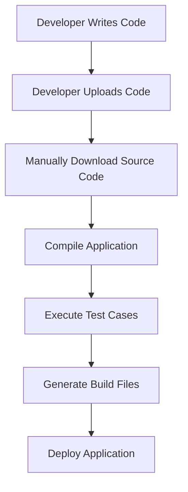
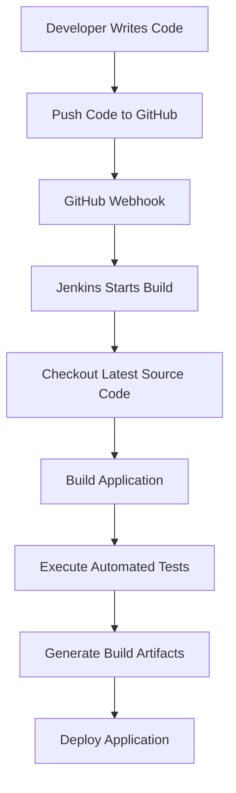

# 3. How Does Jenkins Solve This Problem?

## 3.1 Introduction

Jenkins automates repetitive software development activities.

Instead of performing software delivery activities manually, we configure Jenkins to execute them automatically whenever a particular trigger occurs.

For example, whenever a developer pushes code to GitHub, Jenkins can automatically:

1. Detect the code changes.
2. Download the latest source code.
3. Build the application.
4. Execute automated test cases.
5. Generate build artifacts.
6. Deploy the application to the required environment.

**Note:** A GitHub webhook, polling mechanism, or another configured trigger is required to initiate the Jenkins job.

## 3.2 Workflow Without Jenkins

In a manual software delivery process, engineers perform each activity themselves.

### Explanation

- Developers write and upload application code.
- Engineers manually download the latest code.
- The application is compiled.
- Test cases are executed manually.
- Build files are generated.
- The application is deployed to a server.

## 3.3 Workflow With Jenkins

With Jenkins, we automate these activities.

### Explanation

1. Developer writes application code.
2. Developer pushes code to GitHub.
3. GitHub sends a webhook notification.
4. Jenkins receives the notification and starts the configured job.
5. Jenkins checks out the latest source code.
6. Jenkins builds the application.
7. Jenkins executes automated test cases.
8. Jenkins generates build artifacts.
9. Jenkins deploys the application to the required environment.

## 3.4 Manual Process vs Automated Process

| Activity | Without Jenkins | With Jenkins |
|---|---|---|
| Code retrieval | Manual | Automated |
| Application build | Manual | Automated |
| Testing | Manual execution | Automated execution |
| Artifact generation | Manual | Automated |
| Deployment | Manual | Automated |
| Execution status | Manual tracking | Jenkins dashboard and logs |

## 3.5 Conclusion

Jenkins solves the problems associated with manual software delivery by automating repetitive development activities.

It helps teams build, test, and deploy applications consistently and efficiently.

**Important:** Jenkins executes the tasks according to the pipeline or job configuration provided by the DevOps engineer.
