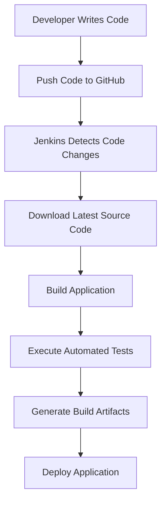

# 1.4 How Does Jenkins Work? (Basic Understanding)

Let's understand Jenkins with a simple example.

Imagine a developer makes changes to an application and pushes the code to GitHub.

Jenkins can be configured to detect these changes and start an automated workflow.

### Basic Jenkins Workflow

### Step-by-Step Explanation

**Step 1: Developer Writes Code**

A developer writes or modifies application source code.

**Step 2: Push Code to GitHub**

The developer uploads the latest changes to a GitHub repository.

**Step 3: Jenkins Detects Code Changes**

Jenkins receives a trigger, such as a GitHub webhook, and starts the configured job or pipeline.

**Step 4: Download Latest Source Code**

Jenkins retrieves the application source code from the GitHub repository. This process is called Source Code Checkout.

**Step 5: Build Application**

Jenkins executes the required build commands to compile or package the application.

**Step 6: Execute Automated Tests**

Jenkins executes configured test cases to verify application functionality.

**Step 7: Generate Build Artifacts**

Jenkins can preserve the generated application files, such as JAR, WAR, or other build outputs.

**Step 8: Deploy Application**

If the required stages succeed, Jenkins can execute the configured deployment process.

**Important:** Jenkins does not automatically know how to perform all these activities. We must configure the required jobs, pipelines, tools, commands, and permissions.
